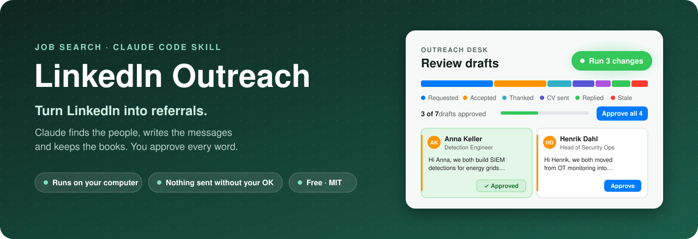
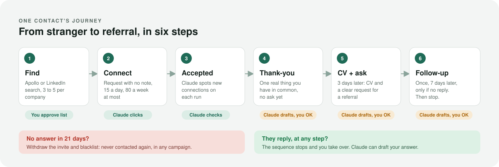
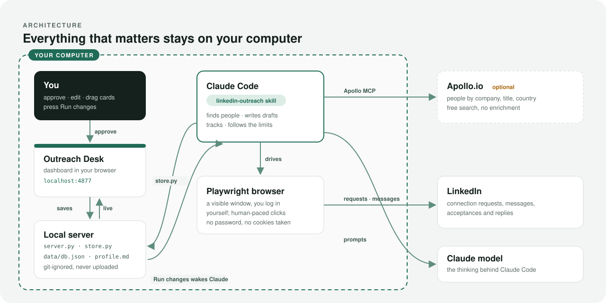
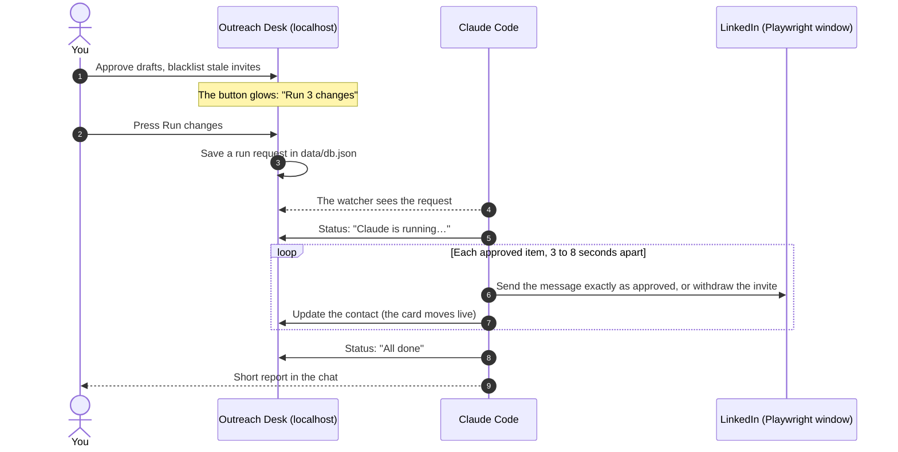
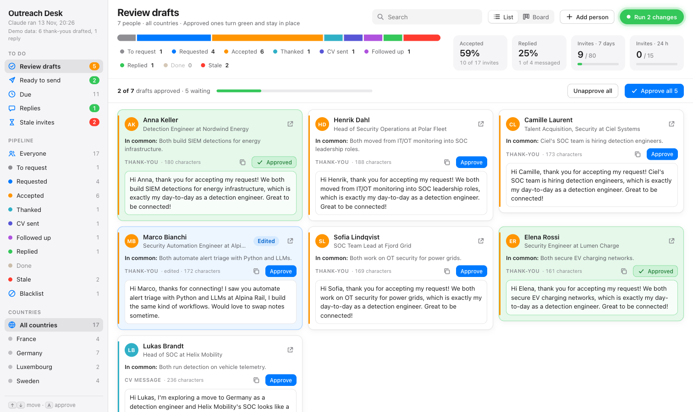
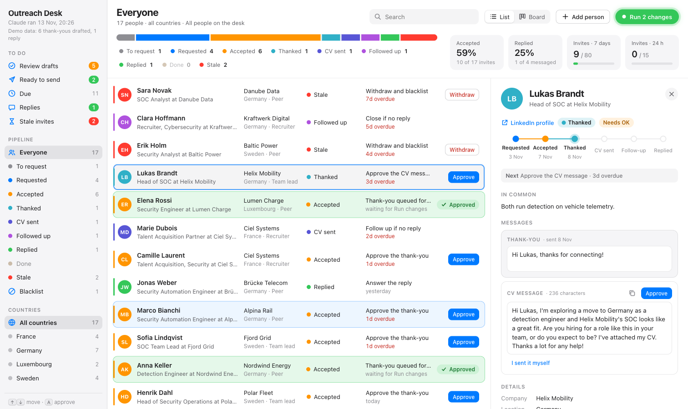
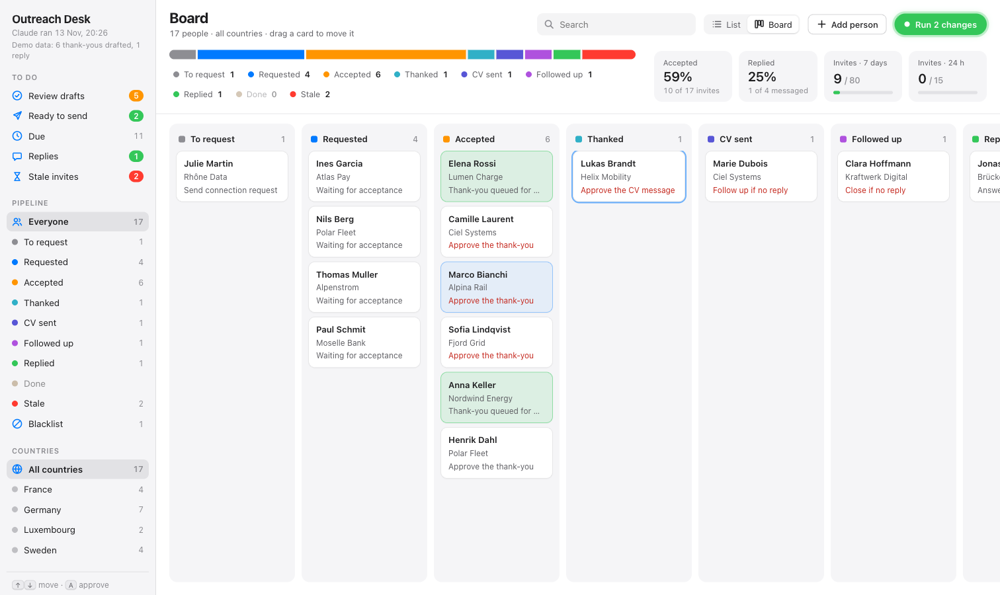
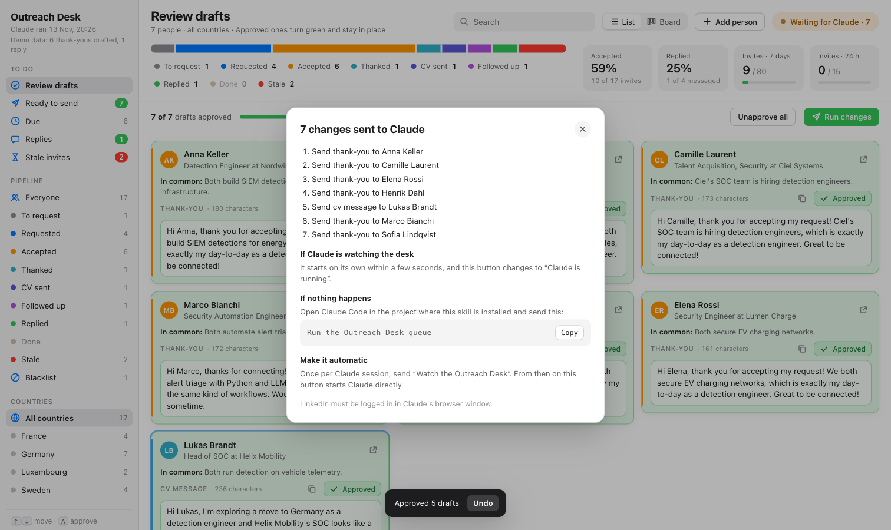
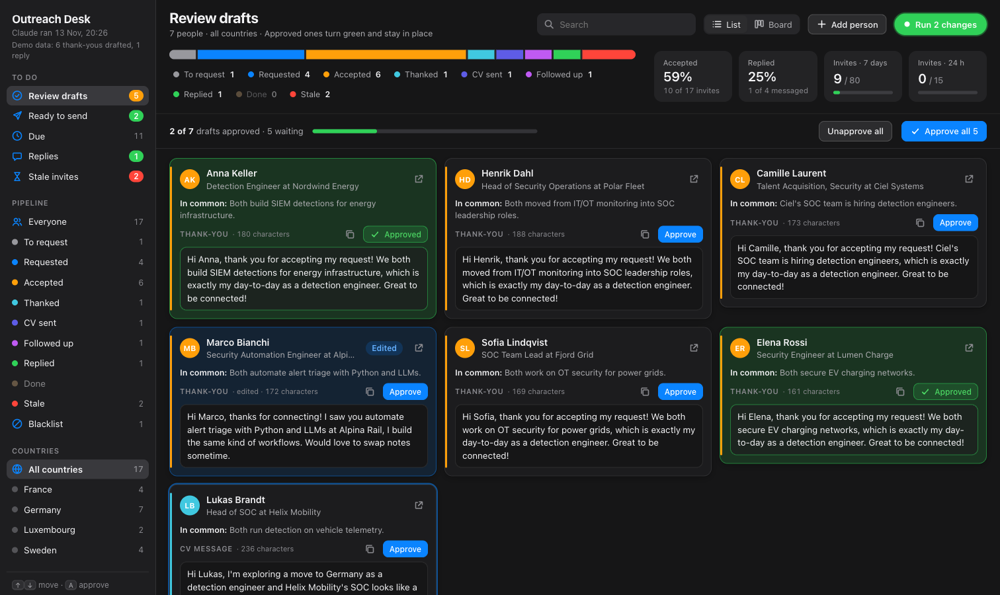

<p align="center">
  
</p>

<p align="center">
  
  
  
  
  
</p>

<p align="center">
  <a href="#quick-start">Quick start</a> ·
  <a href="#how-it-works">How it works</a> ·
  <a href="#the-dashboard">Dashboard</a> ·
  <a href="#using-it-with-claude">Using it with Claude</a> ·
  <a href="#using-it-by-hand">Using it by hand</a> ·
  <a href="#safety-and-privacy">Safety</a>
</p>

---

## Cold applications disappear. Referrals get read.

The fastest way into a company is someone who already works there. Getting there is slow, though: you have to find the right people, write each one a message that doesn't sound like a template, remember who accepted, send your CV at the right moment, follow up once, and keep track of it all across dozens of people and several countries.

**LinkedIn Outreach turns that into a 10-minute daily routine.** You tell Claude which country to work on. Claude finds people in your field, sends connection requests at a human pace, notices who accepts, and drafts a thank-you that mentions **one real thing you have in common**. A few days later it drafts a CV message with a clear request for a referral. You read each draft, edit it if you like, approve it, and press one button.

### What makes it different

|  |  |
|---|---|
| **Personal, not templated** | Claude reads each person's profile and writes about something you actually share: a tool, a domain, a city, a university, a project of theirs. No "I came across your profile and would love to connect". |
| **You approve every word** | Nothing reaches LinkedIn until you approve it. Claude drafts and does the clicking; you decide who to contact, what gets sent and how to answer replies. |
| **Runs on your computer** | No cloud service holds your LinkedIn session. You log in yourself in a visible browser window, and your contacts live in one file on your machine. |
| **Built-in brakes** | 15 requests a day, 80 a week, human-paced clicks, invites with no answer withdrawn after 21 days, and a blacklist so nobody is contacted twice. |
| **A real dashboard** | Review every draft as a card, **Approve all** in one click, colour that shows what you've done, a drag-and-drop board and a blacklist, on `localhost`. |
| **Free and hackable** | MIT licensed, plain Python with no packages to install, a single HTML page. Make it yours. |

---

## Quick start

```bash
# 1. Put the skill where Claude Code finds it (all projects)
git clone https://github.com/contactmishra/linkedin-outreach ~/.claude/skills/linkedin-outreach

# 2. Run the setup check (it asks before changing anything)
cd ~/.claude/skills/linkedin-outreach && python3 install.py

# 3. Restart Claude Code, then say:
#    set up linkedin outreach
```

That's it. Claude opens the dashboard, opens a LinkedIn window for you to log in, reads your profile and asks a few questions. Full details are in [Setup](#setup).

---

## How it works

<p align="center"></p>

Every contact moves through the same six steps. Claude does the work in each step; the orange steps wait for your approval. When someone replies, the sequence stops for them and the conversation is yours.

### Architecture

<p align="center"></p>

| Part | What it is |
|---|---|
| **The skill** (`SKILL.md`) | The playbook Claude follows: workflows, limits, message rules. |
| **Playwright browser** | A real browser window Claude controls through the [Playwright MCP server](https://github.com/microsoft/playwright-mcp). You log in to LinkedIn there yourself. |
| **Apollo** (optional) | Finds people by company, title and country through Apollo's official MCP server. Its people search uses no credits. |
| **Outreach Desk** | A small local web app: `server.py` (Python standard library) serves the dashboard and keeps everything in `data/db.json`. |
| **Store CLI** (`store.py`) | How Claude reads and updates your contacts. File locking makes it safe while the dashboard is open. |

### What happens when you press "Run changes"



No Claude session watching? The button tells you the one line to paste into Claude instead: `Run the Outreach Desk queue`.

---

## The dashboard

<p align="center"></p>

The **Outreach Desk** is built like a Mac app: a sidebar with your to-do lists, the list in the middle, and the person you open on the right. It fills the whole window, so there's very little scrolling.

- **Review drafts.** Every message waiting for you is a card you can read and edit in place. Approve one, or press **Approve all**, which you can undo. A counter shows how many are done: *3 of 7 drafts approved*.
- **Colour tells you what you've done.** Approved turns **green**, edited turns **blue**, sent fades to **grey**, a queued withdrawal turns **red**. Cards stay where they are, so you never lose your place.
- **One colour per stage.** The pipeline bar on top splits everyone by stage (requested, accepted, thanked, CV sent, replied, stale…), and the same colours run through the sidebar, rows, board and each person's journey.
- **Limits you can see.** Invites in the last 24 hours and 7 days turn orange near the limit and red above it.
- **Keyboard first.** `↑` `↓` move through the list, `A` approves (or undoes), `/` searches, `Esc` closes.

<table>
<tr>
<td width="50%"><br><b>Everyone.</b> Rows tinted by state, next step and due date, inline Approve. Open someone to see their journey, messages, notes and history.</td>
<td width="50%"><br><b>Board.</b> One column per stage in its own colour. Drag a card to move someone, or drop it on <b>Blacklist</b>.</td>
</tr>
<tr>
<td width="50%"><br><b>Run changes.</b> Everything you approved, in one list. One press sends it.</td>
<td width="50%"><br><b>Dark mode.</b> Follows your system setting.</td>
</tr>
</table>

<p align="center"><i>All screenshots use invented demo data.</i></p>

---

## Requirements

| Needed | Why |
|---|---|
| [Claude Code](https://claude.com/claude-code) | Runs the skill |
| Python 3.9 or newer | The dashboard and data store (standard library only, nothing to `pip install`) |
| [Node.js](https://nodejs.org) | Runs the Playwright browser server (`npx @playwright/mcp`) |
| A LinkedIn account | The one you're job hunting with |
| *Optional:* an [Apollo.io](https://www.apollo.io) account | Better people search by company, title and country. Without it, Claude searches on LinkedIn. |

Works on macOS, Linux and Windows. The double-click `Outreach Desk.app` is macOS only; on other systems Claude opens the dashboard for you, or you run `python3 app/launch.py`.

---

## Setup

**1. Install the skill.** Clone it into a Claude skills folder:

```bash
# for all your projects
git clone https://github.com/contactmishra/linkedin-outreach ~/.claude/skills/linkedin-outreach

# or for one project only
git clone https://github.com/contactmishra/linkedin-outreach <your-project>/.claude/skills/linkedin-outreach
```

**2. Run the setup check.**

```bash
cd ~/.claude/skills/linkedin-outreach
python3 install.py
```

It checks Python and Claude Code, then **asks** before:
- adding the Playwright browser server to Claude (required)
- adding Apollo to Claude (optional)
- building `Outreach Desk.app` on macOS (drag it to your Dock)

**3. Restart Claude Code** so it loads the new servers. If you added Apollo: type `/mcp`, choose **apollo** and sign in. If Claude asks whether to approve a project server, say yes.

**4. First run.** In Claude Code, say:

> **set up linkedin outreach**

Claude opens the dashboard and a LinkedIn window. **Log in there yourself** (LinkedIn may send you a verification code the first time). Claude then reads your profile, fills in `data/profile.md` (target roles, search keywords, industries, things you could have in common with people) and asks only what it can't work out: target countries, where your CV PDF is, message language, anyone not to contact. If you've already sent requests by hand, Claude can import them.

---

## Using it with Claude

Every time the skill runs, the dashboard opens first (or stays open, if it already is).

| You say | Claude does | You get |
|---|---|---|
| **start a campaign for Germany** | Finds companies in your field (hiring ones first), picks 3 to 5 people per company (peers, team leads, recruiters), drops anyone already contacted or blacklisted | A list to approve or trim. Requests then go out at most 15 a day |
| **run today's outreach** | Checks acceptances and replies, writes thank-you / CV / follow-up drafts, flags stale invites, proposes today's requests | A short summary and drafts waiting on the dashboard |
| **Watch the Outreach Desk** | Waits in the background for the Run changes button | Hands-free sending for this session |
| **Run the Outreach Desk queue** | Sends what you approved, withdraws what you blacklisted | Cards move as each step finishes |
| **check who accepted** · **who replied?** | Just that | A list |
| **draft a reply to Anna** | Writes an answer for you to send yourself | A draft |
| **open the outreach desk** | Starts and opens the dashboard | |

**A typical day (about 10 minutes):**
1. Start Claude Code and say **Watch the Outreach Desk**, then **run today's outreach**.
2. On the dashboard, open **Review drafts**: read the cards, edit any you want, then **Approve** them one by one or **Approve all**. They turn green. Under **Stale invites**, click **Withdraw**.
3. Press the glowing **Run changes** button.
4. Answer any replies yourself, then click **They replied** on that person.

---

## Using it by hand

Not everything needs Claude. Pick the level that suits you:

| Level | What you use | Good for |
|---|---|---|
| **Full** | Claude + Playwright (+ Apollo) | The routine above: Claude finds, drafts, clicks and tracks |
| **Claude without the browser** | Claude + the dashboard | You do the clicking on LinkedIn; Claude still finds people (Apollo), writes drafts and keeps the tracker |
| **Dashboard only** | Just the Outreach Desk | A clean CRM for your own outreach, no AI at all |

**Dashboard only, step by step:**

```bash
python3 app/launch.py          # start and open http://localhost:4877
python3 app/launch.py --stop   # stop it
```

- **Add person**: name, LinkedIn URL, company, country, group, and whether you've already sent the request.
- Drag cards on the **Board** as people move along (accepted, thanked, CV sent…).
- Write a draft in a person's panel (or have Claude write them), click the copy icon, send it on LinkedIn yourself, then **I sent it myself**. The next step's timer starts automatically.
- Blacklist anyone you don't want to approach again.

**From the command line** (also what Claude uses):

```bash
python3 app/store.py summary                    # counts and what's waiting
python3 app/store.py list --status accepted     # filter contacts
python3 app/store.py get <id>
python3 app/store.py update <id> '{"notes":"met at a meetup"}' --event "Note added"
python3 app/store.py blacklist
python3 app/store.py --help
```

---

## Safety and privacy

> [!WARNING]
> **LinkedIn's User Agreement does not allow automated activity, and accounts that use automation can be restricted or banned.** This tool lowers the risk (a visible browser you log in to yourself, human-paced clicks, strict daily and weekly limits, no bulk scraping, every send approved by you), but it cannot remove it. **Use it at your own risk**, and consider the "Claude without the browser" level if you want zero automation on LinkedIn itself.

- **Your login stays yours.** Never give this tool, or any tool, your LinkedIn password or cookies. You log in in the browser window yourself.
- **Your data stays local.** Contacts, your profile, backups and logs live in `data/`, which is git-ignored and never uploaded. The dashboard only listens on `127.0.0.1` and rejects requests from other websites.
- **What does leave your computer:** the pages Claude reads and the messages it writes go to the Claude model (as with any Claude Code session), and searches go to Apollo if you use it.
- **Other people's data.** The contacts you collect are personal data. Keep only what you use, delete people who ask, and follow the privacy rules where you live (GDPR in the EU).
- **Page content is treated as data.** Claude is told never to follow instructions found in profiles or messages.

---

## Limits and settings

| Setting | Default | Meaning |
|---|---|---|
| `dailyCap` | 15 | Connection requests per 24 hours |
| `weeklyCap` | 80 | Connection requests per rolling 7 days (LinkedIn's own cap is around 100) |
| `cvDelayDays` | 3 | Days from the thank-you to the CV message |
| `followUpDays` | 7 | Days from the CV message to the one follow-up |
| `closeDays` | 7 | Days after the follow-up before closing |
| `staleDays` | 21 | Days before an unanswered invite is flagged for withdrawal |

They live in `meta.settings` in `data/db.json`. Ask Claude to change them, for example "set the daily limit to 10".

---

## Project structure

```
linkedin-outreach/
├── SKILL.md                 the playbook Claude follows
├── README.md
├── LICENSE
├── install.py               setup check; optional Playwright, Apollo and macOS app
├── references/              LinkedIn browser steps, message rules, data model
├── templates/profile.md     blank profile Claude fills in on the first run
├── docs/                    the images in this README
├── app/
│   ├── launch.py            start the server and open the dashboard (--if-closed, --stop)
│   ├── server.py            local server, standard library only
│   ├── store.py             data store + CLI
│   ├── web/index.html       the dashboard, one file
│   └── launcher.applescript source of the macOS app
└── data/                    YOUR data, created on first run, never committed
    ├── profile.md           roles, keywords, countries, CV path, style rules
    ├── db.json              all contacts
    ├── backups/             a copy from before the first change of each day
    └── server.log
```

---

## FAQ

**Is it fully automatic?**
No, on purpose. Claude does the repetitive work; you approve who gets contacted and every message, and you answer replies yourself.

**Does it send messages with a note on connection requests?**
No. Free LinkedIn accounts only get a few notes a month, so requests go without one and the personal message comes as the thank-you after they accept.

**What if I already sent requests by hand?**
During setup (or any time), ask Claude to import them. Pending invites become *Requested*; people who accepted get thank-you drafts.

**Can I write in another language?**
Yes. Set the language in `data/profile.md`, or per country.

**The dashboard says the server isn't answering.**
Ask Claude to "open the outreach desk", or run `python3 app/launch.py`.

**Port 4877 is taken.**
Set `OUTREACH_PORT` to another port in your environment.

**Apollo tools don't show up.**
Restart Claude Code, approve the server if asked, then `/mcp` → apollo → sign in.

**How do I uninstall it?**
Delete the `linkedin-outreach` folder; that removes the skill, the dashboard and your data. To remove the servers from Claude: `claude mcp remove playwright` and `claude mcp remove apollo`.

---

## License

MIT, see [LICENSE](LICENSE). Not affiliated with LinkedIn, Apollo or Anthropic.
